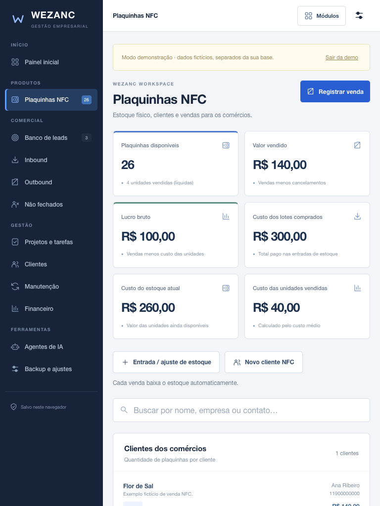

# Sistema Wezanc — gestão comercial e plaquinhas NFC

Recriação do Wezanc OS para iPad, celular e desktop. Funciona inteiramente no navegador, sem login, backend ou banco de dados externo. Não envia leads ou informações financeiras a serviços externos.

## Publicar na Vercel

Importe esta pasta em um repositório e conecte à Vercel. A configuração `vercel.json` usa:

- Framework: **Other**
- Build Command: `npm run build`
- Output Directory: `dist`

Sem variáveis de ambiente ou dependências de produção. `npm run dev` abre a prévia em http://127.0.0.1:8080. Para publicação por CLI, executar `npx vercel` a partir desta pasta, após entrar na sua própria conta.

## Preservação dos leads

1. Cada edição é gravada em `localStorage` em uma única operação; a confirmação só aparece quando a gravação termina.
2. Cópia da última versão válida em outra chave e histórico de 50 versões em IndexedDB.
3. Configurações → Histórico automático permite revisar e restaurar versões.
4. Falhas de quota ou armazenamento não são tratadas como sucesso: o app avisa e oferece exportação da edição em memória.
5. Edições antigas de outra aba são verificadas antes da gravação para reduzir sobrescritas acidentais.
6. Backup JSON independente para guardar em Arquivos / iCloud Drive e importar em outro dispositivo.
7. Solicitação opcional de armazenamento persistente quando o navegador oferecer suporte.

**Não existe garantia de risco zero com armazenamento apenas no navegador.** Limpar os dados do site, navegação privada, perda do aparelho, remoção do perfil ou políticas de armazenamento podem apagar os dados e o histórico local. Mantenha backups fora do navegador. Usar sempre o mesmo domínio da Vercel; novos domínios e URLs de preview têm bases separadas. Um deploy no mesmo domínio não apaga a base.

**iPad e celular não sincronizam automaticamente.** Exportar e importar JSON transfere a base. O cache do service worker guarda a interface para uso offline; os registros de negócio ficam separados em localStorage/IndexedDB. Após o primeiro carregamento online e a instalação do cache, funciona offline. Uma atualização de interface nunca limpa os registros.

## Migração do sistema original

No Wezanc OS original, use **Exp** para exportar JSON. No novo sistema: **Configurações → Importar backup**. Compatível com clientes, prospects, transações e tarefas do formato v43/v44. Valida estrutura, IDs duplicados e valores financeiros. A importação substitui a base após confirmação e mantém histórico local.

## Plaquinhas NFC

Acesse **Plaquinhas NFC** pelo menu lateral no iPad, pelo botão NFC no celular ou pelos acessos rápidos da tela inicial.

1. Em **Entrada / ajuste de estoque**, informe a quantidade do lote e o **custo total pago**. O primeiro lote também pode representar o estoque que você já tem em mãos.
2. Em **Registrar venda**, selecione um comércio ou cadastre um novo, informe a quantidade e o **valor total da venda**. A baixa no estoque acontece junto com o registro da venda.
3. O painel mostra unidades disponíveis, valor vendido, custo dos lotes, custo do estoque restante, custo das unidades vendidas e lucro bruto.
4. O custo usa média ponderada por unidade, com valores monetários em centavos. Novos lotes atualizam o custo médio apenas do estoque disponível; vendas antigas mantêm seu custo registrado.
5. Cancelar uma venda devolve a quantidade e seu custo original ao estoque e desconta seu valor das vendas. O mesmo cancelamento não pode ser aplicado duas vezes.
6. Saídas por avaria ou correção exigem motivo e saldo suficiente. Remover um cadastro de cliente preserva os registros anteriores e não altera o estoque.

O lucro bruto é **valor vendido menos custo das unidades vendidas**, antes de outras despesas e impostos. O valor vendido indica vendas registradas; não implica recebimento e não gera automaticamente um lançamento no Financeiro. O custo dos lotes representa compras registradas, sem presumir a data de pagamento.

Os registros NFC acompanham o backup JSON, o histórico de recuperação e a gravação local. Bases anteriores ao módulo continuam compatíveis e começam com estoque zero. Restaurar um backup anterior substitui também os dados NFC; confira o resumo antes de confirmar.

## Interface corporativa e navegação no iPad

Identidade visual em grafite e azul, cabeçalho fixo, superfícies com bordas discretas, indicadores numéricos e tabelas de clientes. O tema compartilhado está em `frontend/enterprise.css`.

Menu lateral permanente a partir de 700px, NFC em destaque, botão **Módulos** em todas as telas e oito atalhos grandes no painel inicial. Em telas menores, a barra inferior inclui acesso direto ao NFC. Formulários e áreas de toque foram verificados em WebKit com 375, 390, 768, 1024 e 1440px.

## Funcionalidades

- Leads: cadastro, edição, busca, exclusão e conversão para outbound.
- Inbound/outbound: filtros e seleção de etapas por toque.
- Clientes: contatos, notas, WhatsApp, perdas e retomadas.
- Projetos: checklists e tarefas adicionais.
- Garantia: prazo de 30 dias a partir da entrada nessa etapa.
- Manutenção: planos mensais e confirmação de recebimento por competência.
- Financeiro: valores efetivamente recebidos, despesas, filtros e relatório imprimível.
- Agentes Gemini: links originais; sem envio automático de dados.
- Demonstração para portfólio: dados fictícios separados da base real.
- PWA: atalho na tela inicial e funcionamento offline após carregar o app.

O valor recebido não representa uma proposta pendente. MRR previsto é separado de receita recebida. Excluir um cliente preserva os recebimentos financeiros. O gerador original de contratos jurídicos não está incluído.

## Estrutura

`frontend/app.js`: interface e persistência. `frontend/style.css`: visual responsivo. `frontend/sw.js`: cache offline da interface. `scripts/build.mjs`: build estático. `vercel.json`: configuração de deploy e cabeçalhos.

## Testes do módulo NFC

O aplicativo não exige dependências. Os testes de navegador em `tests/nfc.cjs` usam Playwright/WebKit instalado separadamente. Com o servidor local em execução: `node tests/nfc.cjs`. É possível informar `PLAYWRIGHT_MODULE`, `PLAYWRIGHT_BROWSERS_PATH`, `WEZANC_TEST_URL` e `WEZANC_SCREENSHOT_DIR` para a instalação local dos testes.

Os testes usam um contexto de navegador isolado, sem alterar os registros da sua sessão.
